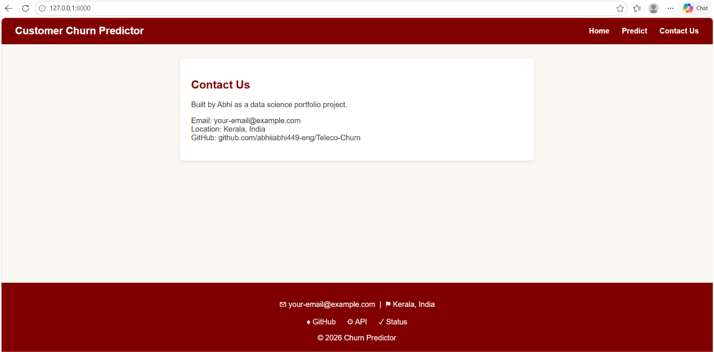

# Telco Customer Churn Prediction

Predicts which telecom customers are likely to leave, using the Telco Customer Churn dataset (7,043 customers, 21 columns). Includes a trained model, a Django REST API and a web page.

## Findings
- Month-to-month customers churn at 42.7%, versus 2.8% for two-year contracts.
- Churned customers have much shorter tenure.

## Method
- Cleaned TotalCharges (11 blank values for brand-new customers set to 0).
- One-hot encoded categorical columns, 80/20 stratified train/test split.
- Compared Logistic Regression (scaled) and Random Forest.

## Results
| Model | Accuracy | Churn recall |
|---|---|---|
| Logistic Regression | 0.807 | 0.57 |
| Random Forest | 0.793 | 0.51 |

Lowering the decision threshold to 0.4 raises churn recall to 0.67 at the cost of more false alarms. The API uses a threshold of 0.4.

## Project structure
    data/        dataset (churn.csv)
    src/         data preparation, EDA and training scripts
    models/      saved model (churn_model.pkl) and feature list (columns.json)
    reports/     charts and screenshots
    predictor/   Django app (views and web page template)
    config/      Django project settings

## How to run
    pip install -r requirements.txt
    python src/train.py          # trains and saves the model
    python manage.py runserver   # starts the web app and API

## Web app
Open http://127.0.0.1:8000/ in your browser.

## API
POST `/api/predict/` with JSON, for example:

    {"tenure": 2, "MonthlyCharges": 70.7, "TotalCharges": 151.65,
     "InternetService_Fiber optic": 1, "PaymentMethod_Electronic check": 1}

Response:

    {"churn_probability": 0.6, "prediction": 1}

Columns not sent default to 0 (the baseline category).

## Next steps
Docker, deployment.